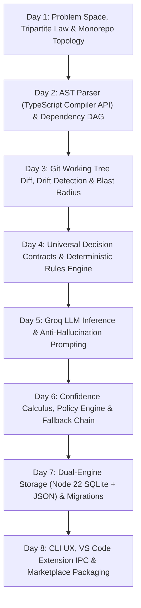

# VIBE 8-Day Reverse-Engineering & Codebase Mastery Curriculum
## Complete Day-by-Day Study Plan (2 Hours/Day)

*Target: From first-principles reverse engineering to acing CTO-level technical interviews and code deep dives.*

Refer to the complete master document: [`VIBE_8_DAY_MASTER_STUDY_PLAN.md`](file:///C:/Users/tejak/.gemini/antigravity/brain/646f460b-0f38-4f3b-8e98-204a888d820f/VIBE_8_DAY_MASTER_STUDY_PLAN.md)

---

### Daily Roadmap Summary

---

### Day-by-Day Breakdown

#### **Day 1: Problem Space, The Tripartite Law & Monorepo Genesis**
- **Core Concept**: Why Copilot/Cursor/ESLint fail to solve architectural drift. The Tripartite Invariant: *Facts are deterministic $\to$ AI interprets $\to$ Policy decides*.
- **Files to Read**:
  - [`package.json`](file:///c:/Programming/Projects/05_Social-Impact/vibe-v1/vibe/package.json) (Root monorepo workspace)
  - [`tsconfig.base.json`](file:///c:/Programming/Projects/05_Social-Impact/vibe-v1/vibe/tsconfig.base.json) (Compiler options)
  - [`.gitignore`](file:///c:/Programming/Projects/05_Social-Impact/vibe-v1/vibe/.gitignore) (Isolation boundaries)
- **Key Takeaway**: Understanding npm workspaces separation between engines and consumer packages.

#### **Day 2: Deterministic Static Analysis & AST Engine**
- **Core Concept**: How VIBE parses real-world codebases without executing them, generating an in-memory Dependency DAG.
- **Files to Read**:
  - [`packages/core/src/types.ts`](file:///c:/Programming/Projects/05_Social-Impact/vibe-v1/vibe/packages/core/src/types.ts)
  - [`packages/core/src/scanner.ts`](file:///c:/Programming/Projects/05_Social-Impact/vibe-v1/vibe/packages/core/src/scanner.ts) (`ts.createSourceFile`, AST visitors)
  - [`packages/core/src/graph.ts`](file:///c:/Programming/Projects/05_Social-Impact/vibe-v1/vibe/packages/core/src/graph.ts) (Adjacency lists)
- **Key Takeaway**: Fault-tolerant AST traversal with the TypeScript Compiler API.

#### **Day 3: Git Diff Intelligence, Drift Detection & Risk Scoring**
- **Core Concept**: Working tree diff parsing, detecting unauthorized framework imports, and computing transitive blast radius.
- **Files to Read**:
  - [`packages/core/src/git.ts`](file:///c:/Programming/Projects/05_Social-Impact/vibe-v1/vibe/packages/core/src/git.ts) (`simple-git` integration)
  - [`packages/core/src/guard.ts`](file:///c:/Programming/Projects/05_Social-Impact/vibe-v1/vibe/packages/core/src/guard.ts) (Secret scanners & line diffs)
  - [`packages/core/src/architecture.ts`](file:///c:/Programming/Projects/05_Social-Impact/vibe-v1/vibe/packages/core/src/architecture.ts) (Drift checks)
  - [`packages/core/src/impact.ts`](file:///c:/Programming/Projects/05_Social-Impact/vibe-v1/vibe/packages/core/src/impact.ts) (BFS graph walking)
- **Key Takeaway**: Multiplicative risk formulation: $\text{Total Diff Risk} = 1.0 - \prod (1.0 - R_c)$.

#### **Day 4: Universal Decision Contracts & Deterministic Rules Engine**
- **Core Concept**: The Strategy Pattern for decision providers and strictly normalized evidence payloads.
- **Files to Read**:
  - [`packages/decision-core/src/types.ts`](file:///c:/Programming/Projects/05_Social-Impact/vibe-v1/vibe/packages/decision-core/src/types.ts) (`DecisionRequest`, `Evidence`, `DecisionResult`)
  - [`packages/decision-providers/rules/src/rules-provider.ts`](file:///c:/Programming/Projects/05_Social-Impact/vibe-v1/vibe/packages/decision-providers/rules/src/rules-provider.ts)
- **Key Takeaway**: Sub-millisecond deterministic evaluation with zero network dependencies.

#### **Day 5: AI Inference Adapters & Groq LLM Integration**
- **Core Concept**: Low-temperature reasoning (0.1) grounded in structural evidence without hallucination.
- **Files to Read**:
  - [`packages/decision-providers/llm/src/llm-provider.ts`](file:///c:/Programming/Projects/05_Social-Impact/vibe-v1/vibe/packages/decision-providers/llm/src/llm-provider.ts)
- **Key Takeaway**: Prompt anti-injection techniques and JSON markdown fence sanitization.

#### **Day 6: Confidence Calculus, Policy Engine & Fallbacks**
- **Core Concept**: Mathematical policy pipeline converting confidence and evidence quality into governance actions.
- **Files to Read**:
  - [`packages/policy-engine/src/confidence.ts`](file:///c:/Programming/Projects/05_Social-Impact/vibe-v1/vibe/packages/policy-engine/src/confidence.ts)
  - [`packages/policy-engine/src/policy.ts`](file:///c:/Programming/Projects/05_Social-Impact/vibe-v1/vibe/packages/policy-engine/src/policy.ts)
  - [`packages/policy-engine/src/fallback-chain.ts`](file:///c:/Programming/Projects/05_Social-Impact/vibe-v1/vibe/packages/policy-engine/src/fallback-chain.ts)
- **Key Takeaway**: $\text{Final Confidence} = \text{Provider Confidence} \times \text{Evidence Quality}$; action resolution matrix (`ALLOW` / `WARN` / `REVIEW` / `BLOCK`).

#### **Day 7: Dual-Engine Storage Abstraction & SQLite Migration**
- **Core Concept**: Native Node 22 `node:sqlite` persistence without C++ build dependencies, plus lossless JSON migration.
- **Files to Read**:
  - [`packages/storage/src/interfaces/storage-adapter.ts`](file:///c:/Programming/Projects/05_Social-Impact/vibe-v1/vibe/packages/storage/src/interfaces/storage-adapter.ts)
  - [`packages/storage/src/sqlite-adapter.ts`](file:///c:/Programming/Projects/05_Social-Impact/vibe-v1/vibe/packages/storage/src/sqlite-adapter.ts)
  - [`packages/storage/src/migrator.ts`](file:///c:/Programming/Projects/05_Social-Impact/vibe-v1/vibe/packages/storage/src/migrator.ts)
- **Key Takeaway**: Relational table design and atomic migration routines.

#### **Day 8: CLI Ergonomics, VS Code Extension & Marketplace Packaging**
- **Core Concept**: Consumer interfaces, non-blocking IPC execution, TreeView reactivity, and marketplace deployment.
- **Files to Read**:
  - [`packages/cli/src/index.ts`](file:///c:/Programming/Projects/05_Social-Impact/vibe-v1/vibe/packages/cli/src/index.ts) & [`guard.ts`](file:///c:/Programming/Projects/05_Social-Impact/vibe-v1/vibe/packages/cli/src/commands/guard.ts)
  - [`packages/vscode-extension/src/extension.ts`](file:///c:/Programming/Projects/05_Social-Impact/vibe-v1/vibe/packages/vscode-extension/src/extension.ts)
  - [`packages/vscode-extension/package.json`](file:///c:/Programming/Projects/05_Social-Impact/vibe-v1/vibe/packages/vscode-extension/package.json)
- **Key Takeaway**: Full lifecycle from `vibe guard` execution to human override ADR generation and `.vsix` packaging.
