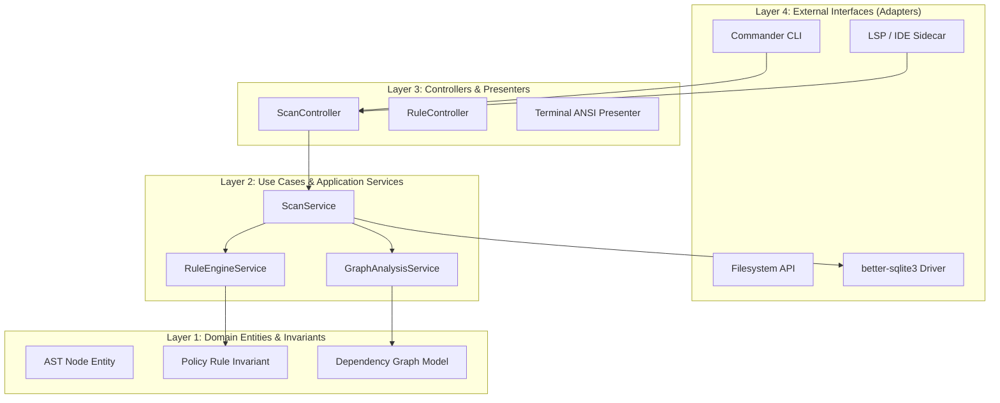

# Backend Engineering Guide 02: Architecture & Design Patterns

This guide covers the core architectural principles, system layers, and design patterns utilized across VIBE's backend codebase.

---

## 1. Clean Architecture & Layered Monolith

VIBE adheres strictly to the principles of **Clean Architecture** (Ports and Adapters / Hexagonal Architecture). The core business logic has **zero dependencies** on external frameworks, databases, or terminal display libraries.



### Layer Responsibilities
1. **Domain Layer (`src/core/domain/`)**: Pure TypeScript models and entities (`Rule`, `Violation`, `ASTNode`, `DependencyEdge`). Contains no I/O, no network calls, and no database logic.
2. **Application Service Layer (`src/core/services/`)**: Orchestrates business use cases (e.g., executing a scan, calculating impact radius). Injects repository interfaces rather than concrete implementations.
3. **Interface Adapters (`src/core/adapters/` & `src/controllers/`)**: Translates CLI flags and IPC payloads into strongly typed DTOs (Data Transfer Objects), and formats domain models for terminal output or JSON output.
4. **Infrastructure Layer (`src/core/infra/`)**: Concrete implementations of I/O (native SQLite drivers, filesystem watchers, git child-process bindings).

---

## 2. Primary Design Patterns in VIBE

### A. The Visitor Pattern (AST Traversal)
The Visitor pattern decouples the AST tree traversal logic from the rule inspection algorithms:

```typescript
export interface ASTVisitor {
  visitImportDeclaration?(node: ImportDeclaration): void;
  visitFunctionDeclaration?(node: FunctionDeclaration): void;
  visitCallExpression?(node: CallExpression): void;
  visitVariableDeclaration?(node: VariableDeclaration): void;
}

export class ASTTraverser {
  public static walk(node: ASTNode, visitor: ASTVisitor): void {
    const method = `visit${node.type}` as keyof ASTVisitor;
    if (typeof visitor[method] === 'function') {
      (visitor[method] as Function)(node);
    }

    for (const child of node.children || []) {
      this.walk(child, visitor);
    }
  }
}
```

### B. The Strategy Pattern (Rule Enforcement)
Different rules require completely different evaluation engines (regex heuristics, AST syntax queries, Shannon entropy calculation, or LLM inference). The Strategy pattern allows the `RuleEngine` to execute disparate policies uniformly:

```typescript
export interface RuleStrategy {
  readonly id: string;
  readonly severity: 'error' | 'warn' | 'info';
  evaluate(context: EvaluationContext): RuleViolation[];
}

export class SecretEntropyStrategy implements RuleStrategy {
  readonly id = 'SEC-001';
  readonly severity = 'error';
  evaluate(context: EvaluationContext): RuleViolation[] {
    // Calculates Shannon entropy over string literals
  }
}

export class CircularDependencyStrategy implements RuleStrategy {
  readonly id = 'ARCH-002';
  readonly severity = 'error';
  evaluate(context: EvaluationContext): RuleViolation[] {
    // Executes DFS 3-coloring cycle detection
  }
}
```

### C. The Repository Pattern (Data Decoupling)
Abstracts data storage operations so the application services can query rules and cache entries without knowing whether they reside in SQLite, in-memory maps, or flat JSON files:

```typescript
export interface IRuleRepository {
  findById(id: string): Promise<Rule | null>;
  findAllActive(): Promise<Rule[]>;
  save(rule: Rule): Promise<void>;
  delete(id: string): Promise<void>;
}

export class SQLiteRuleRepository implements IRuleRepository {
  constructor(private readonly db: Database.Database) {}
  async findById(id: string): Promise<Rule | null> {
    const stmt = this.db.prepare('SELECT * FROM rules WHERE id = ?');
    return stmt.get(id) as Rule | null;
  }
  // ...
}
```

### D. The Observer Pattern (Progress & Event Streams)
Emits granular scan progress events to decouple the CLI terminal spinner, CI log forwarders, and IDE progress bars from the core analysis pipeline:

```typescript
export type ScanEvent = 
  | { type: 'FILE_DISCOVERED'; path: string }
  | { type: 'AST_PARSED'; path: string; nodeCount: number }
  | { type: 'VIOLATION_FOUND'; violation: RuleViolation }
  | { type: 'SCAN_COMPLETED'; durationMs: number };

export class ScanEventBus {
  private listeners: Array<(event: ScanEvent) => void> = [];

  public subscribe(listener: (event: ScanEvent) => void): () => void {
    this.listeners.push(listener);
    return () => {
      this.listeners = this.listeners.filter(l => l !== listener);
    };
  }

  public emit(event: ScanEvent): void {
    for (const listener of this.listeners) {
      listener(event);
    }
  }
}
```

---

## 3. Interview Takeaways
- **Dependency Inversion**: Services depend on abstract interfaces, never on concrete SQLite database connections.
- **Single Responsibility Principle (SRP)**: The AST parser only generates trees; the Graph service only builds adjacency lists; the Rule engine only evaluates violations.
- **Open-Closed Principle (OCP)**: Adding a new rule or scanning strategy requires zero modifications to the core engine orchestrator.
