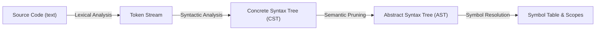
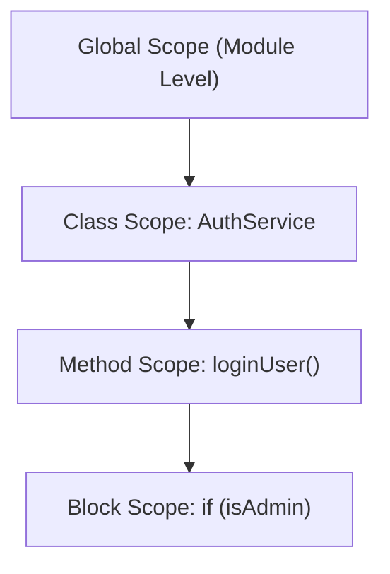

# Backend Engineering Guide 03: AST & Compiler Engine Internals

This guide provides an in-depth exploration of the compiler theory, parsing algorithms, and Abstract Syntax Tree (AST) internals that power VIBE's static analysis engine.

---

## 1. Compiler Theory: From Raw Source to AST

A compiler or static analysis engine converts raw text into an actionable semantic graph through three distinct phases:



### Phase 1: Lexical Analysis (Scanning / Tokenization)
The lexer sweeps the raw UTF-8 string buffer character by character, emitting structured tokens:
```typescript
// Source: const timeout = 5000;
[
  { type: 'Keyword', value: 'const', start: 0, end: 5, line: 1 },
  { type: 'Identifier', value: 'timeout', start: 6, end: 13, line: 1 },
  { type: 'AssignOperator', value: '=', start: 14, end: 15, line: 1 },
  { type: 'NumericLiteral', value: '5000', start: 16, end: 20, line: 1 },
  { type: 'Semicolon', value: ';', start: 20, end: 21, line: 1 }
]
```

### Phase 2: Syntactic Analysis (Parsing)
The parser consumes tokens and validates them against the grammar specifications (Context-Free Grammar). It builds a hierarchical tree representation that guarantees structural validity.

### Phase 3: CST vs. AST
- **Concrete Syntax Tree (CST)**: Preserves every character, including whitespace, comments, commas, and parentheses. CSTs are essential for auto-formatters (e.g., Prettier).
- **Abstract Syntax Tree (AST)**: Retains only the semantic hierarchy. Punctuation and whitespace are discarded, making ASTs significantly lighter and optimal for semantic static analysis.

---

## 2. AST Structure & Tree Traversal

In VIBE, each AST node implements a standardized interface representing its syntactic kind and location:

```typescript
export interface ASTNode {
  type: string;                 // e.g., 'FunctionDeclaration', 'CallExpression'
  start: number;                // Byte start offset
  end: number;                  // Byte end offset
  loc: {
    start: { line: number; column: number };
    end: { line: number; column: number };
  };
  children?: ASTNode[];
  [key: string]: unknown;
}
```

### Depth-First Recursive AST Visitor
VIBE traverses ASTs using a non-allocating, depth-first visitor pattern:

```typescript
export function traverseAST(
  node: ASTNode,
  callbacks: {
    enter?: (node: ASTNode, parent: ASTNode | null) => void;
    leave?: (node: ASTNode, parent: ASTNode | null) => void;
  },
  parent: ASTNode | null = null
): void {
  if (callbacks.enter) {
    callbacks.enter(node, parent);
  }

  for (const key of Object.keys(node)) {
    const child = node[key];
    if (child && typeof child === 'object') {
      if (Array.isArray(child)) {
        for (const item of child) {
          if (item && item.type) {
            traverseAST(item, callbacks, node);
          }
        }
      } else if ((child as ASTNode).type) {
        traverseAST(child as ASTNode, callbacks, node);
      }
    }
  }

  if (callbacks.leave) {
    callbacks.leave(node, parent);
  }
}
```

---

## 3. Symbol Tables & Scope Resolution

To detect variable shadowing, unused imports, or dangerous function calls, VIBE maintains a **Lexical Scope Tree**:



### Scope Resolution Algorithm
When an identifier (e.g., `process.env.SECRET_KEY`) is encountered in a child scope:
1. Search the current `BlockScope` for a local declaration.
2. If unresolved, bubble up to the parent `MethodScope`.
3. Continue upward until reaching `GlobalScope`.
4. If still unresolved, classify the symbol as an **unresolved global reference** or imported external module.

---

## 4. Performance: Incremental AST Caching

Parsing source code repeatedly on every file save is computationally prohibitive for large repositories. VIBE solves this with a **Content-Addressed Cache**:

$$H = \text{SHA-256}(\text{file\_content}) \oplus \text{SHA-256}(\text{parser\_version})$$

1. Before invoking the parser, VIBE computes $H$.
2. It queries SQLite: `SELECT ast_json FROM ast_cache WHERE content_hash = ?`.
3. If a match is found (Cache Hit), the AST is deserialized directly in $< 1\text{ms}$.
4. If missing (Cache Miss), the parser executes, and the AST is persisted to SQLite with its hash.

---

## 5. Senior Interview Questions on ASTs

**Q: Why not use simple regular expressions instead of full AST parsing?**
> *"Regex lacks context and grammar awareness. A regex cannot differentiate between a password variable assignment (`const token = "abc"`) and the same string appearing inside a multi-line comment or test mock. Regex also cannot understand scope, variable reassignments, or inheritance hierarchies. ASTs provide mathematically verified semantic structures, eliminating false positives."*
