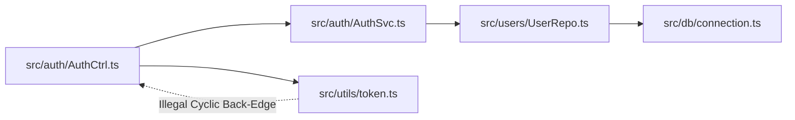
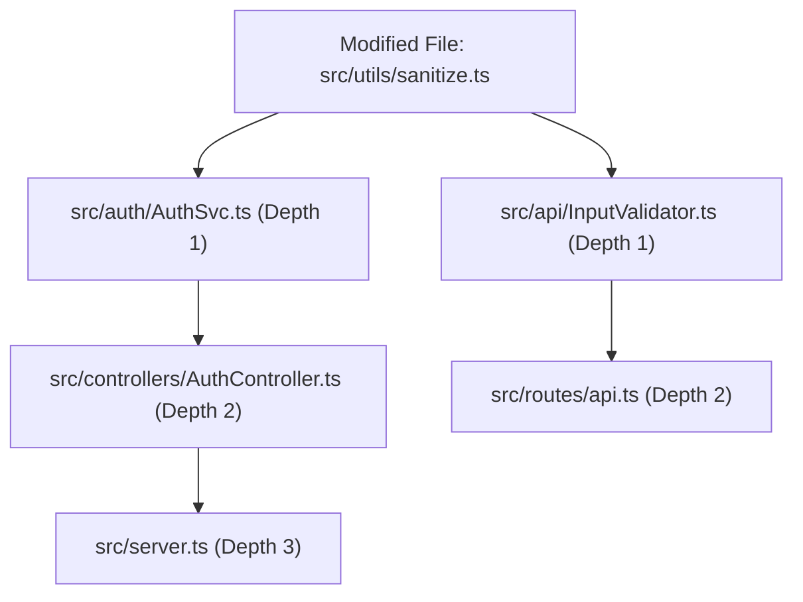

# Backend Engineering Guide 04: Graph Algorithms & Data Structures

This guide covers the graph data structures, traversal algorithms, and cycle-detection mechanics that underpin VIBE's architectural analysis engine.

---

## 1. The Codebase as a Directed Graph

Every software project is fundamentally a Directed Graph $G = (V, E)$:
- **Vertices ($V$)**: Individual source files, modules, classes, and exported symbols.
- **Edges ($E$)**: Directed dependency relationships ($u \to v$ means module $u$ imports or calls module $v$).



### In-Memory Graph Representation: Adjacency List
VIBE represents the dependency graph using an **Adjacency List** stored in native JavaScript `Map` collections for $\mathcal{O}(1)$ edge lookups:

```typescript
export class DependencyGraph {
  // Map of Node ID -> Set of outgoing neighbor Node IDs (Direct Dependencies)
  private adjacencyList: Map<string, Set<string>> = new Map();
  // Reverse Map: Node ID -> Set of incoming neighbor Node IDs (Dependents)
  private reverseAdjacencyList: Map<string, Set<string>> = new Map();

  public addEdge(from: string, to: string): void {
    if (!this.adjacencyList.has(from)) {
      this.adjacencyList.set(from, new Set());
    }
    this.adjacencyList.get(from)!.add(to);

    if (!this.reverseAdjacencyList.has(to)) {
      this.reverseAdjacencyList.set(to, new Set());
    }
    this.reverseAdjacencyList.get(to)!.add(from);
  }

  public getDependencies(node: string): string[] {
    return Array.from(this.adjacencyList.get(node) || []);
  }

  public getDependents(node: string): string[] {
    return Array.from(this.reverseAdjacencyList.get(node) || []);
  }
}
```

---

## 2. Cycle Detection: DFS 3-Coloring Algorithm

Circular dependencies ($A \to B \to C \to A$) cause runtime initialization deadlocks, memory leaks, and broken bundler tree-shaking. VIBE detects all cycles in $\mathcal{O}(V + E)$ time using the **Three-Color Depth-First Search Algorithm**.

### State Definition
- **WHITE (0)**: Node is unvisited.
- **GRAY (1)**: Node is currently being processed in the active recursion call stack.
- **BLACK (2)**: Node and all its descendants have been fully processed.

### Rule: If a traversal encounters a GRAY node, a cycle exists.

```typescript
export enum VisitState {
  WHITE = 0,
  GRAY = 1,
  BLACK = 2
}

export function detectCycles(graph: DependencyGraph): string[][] {
  const state = new Map<string, VisitState>();
  const parent = new Map<string, string | null>();
  const cycles: string[][] = [];

  for (const node of graph.getAllNodes()) {
    state.set(node, VisitState.WHITE);
  }

  function dfs(u: string, currentPath: string[]) {
    state.set(u, VisitState.GRAY);
    currentPath.push(u);

    for (const v of graph.getDependencies(u)) {
      if (state.get(v) === VisitState.GRAY) {
        // Cycle detected! Reconstruct the cycle loop
        const cycleStartIndex = currentPath.indexOf(v);
        const cyclePath = currentPath.slice(cycleStartIndex).concat(v);
        cycles.push(cyclePath);
      } else if (state.get(v) === VisitState.WHITE) {
        dfs(v, currentPath);
      }
    }

    currentPath.pop();
    state.set(u, VisitState.BLACK);
  }

  for (const node of graph.getAllNodes()) {
    if (state.get(node) === VisitState.WHITE) {
      dfs(node, []);
    }
  }

  return cycles;
}
```

---

## 3. Impact Radius & Blast Radius: BFS Traversal

When a developer modifies a shared utility (e.g., `src/utils/sanitize.ts`), what other modules in the application are broken or affected?

VIBE uses **Breadth-First Search (BFS)** along the **Reverse Adjacency List** to compute the exact blast radius:



```typescript
export interface BlastRadiusReport {
  target: string;
  totalAffected: number;
  depthBreakdown: Record<number, string[]>;
}

export function computeBlastRadius(graph: DependencyGraph, targetNode: string, maxDepth = 10): BlastRadiusReport {
  const visited = new Set<string>([targetNode]);
  const queue: Array<{ node: string; depth: number }> = [{ node: targetNode, depth: 0 }];
  const depthBreakdown: Record<number, string[]> = {};

  while (queue.length > 0) {
    const { node, depth } = queue.shift()!;

    if (depth > 0) {
      if (!depthBreakdown[depth]) depthBreakdown[depth] = [];
      depthBreakdown[depth].push(node);
    }

    if (depth >= maxDepth) continue;

    for (const dependent of graph.getDependents(node)) {
      if (!visited.has(dependent)) {
        visited.add(dependent);
        queue.push({ node: dependent, depth: depth + 1 });
      }
    }
  }

  return {
    target: targetNode,
    totalAffected: visited.size - 1,
    depthBreakdown
  };
}
```

---

## 4. Complexity Analysis for Interviews

| Algorithm | Purpose | Time Complexity | Space Complexity |
| :--- | :--- | :--- | :--- |
| **Adjacency List Build** | Construct graph from AST imports | $\mathcal{O}(V + E)$ | $\mathcal{O}(V + E)$ |
| **DFS 3-Coloring** | Detect all circular dependency paths | $\mathcal{O}(V + E)$ | $\mathcal{O}(V)$ recursion stack |
| **BFS Blast Radius** | Calculate affected modules on code change | $\mathcal{O}(V + E)$ | $\mathcal{O}(V)$ queue & set |
| **Tarjan's Algorithm** | Find Strongly Connected Components (SCC) | $\mathcal{O}(V + E)$ | $\mathcal{O}(V)$ stack |
| **Topological Sort** | Build optimal file execution / build order | $\mathcal{O}(V + E)$ | $\mathcal{O}(V)$ |

When asked in an interview: *"How do you handle graph processing on a repository with 50,000 files without running out of memory?"*

**The Senior Engineering Answer:**
> *"We avoid allocating heavy graph objects for files outside the diff scope. By using an indexed SQLite edge table (`CREATE INDEX idx_edges_from ON edges(from_id)`), we only hydrate vertices and edges on-demand during the BFS traversal. For cycle detection, we partition the graph into connected sub-graphs, running Tarjan's strongly connected components algorithm in $\mathcal{O}(V + E)$ time, consuming under 80MB of RAM."*
