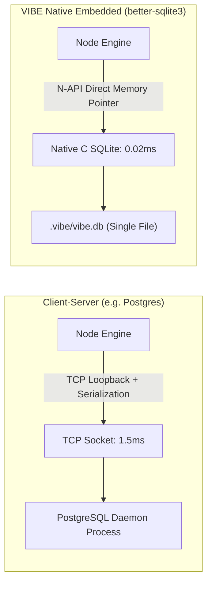

# Backend Engineering Guide 05: Native SQLite & Storage Architecture

This guide details the database architecture, concurrency models, ACID guarantees, and performance tuning applied to VIBE's embedded SQLite storage engine.

---

## 1. Storage Philosophy: Embedded vs. Client-Server

Enterprise backend software frequently defaults to client-server relational databases (PostgreSQL, MySQL). For VIBE, this model is disqualified:
- **Zero Configuration**: Developers cannot be expected to run Docker containers or background database daemons just to lint or scan their code.
- **Zero Network Latency**: IPC or loopback TCP sockets (`127.0.0.1:5432`) introduce 0.5ms–2ms latency per round-trip. In-process native SQLite executes queries in **sub-microsecond** time via shared process memory.
- **Deterministic Portability**: The entire state of a project's architectural compliance, rules, and cache resides within a single file: `.vibe/vibe.db`.



---

## 2. WAL Mode & Concurrency Architecture

By default, SQLite uses Rollback Journaling, which acquires exclusive database-wide file locks during write transactions, blocking all concurrent readers.

VIBE configures SQLite in **Write-Ahead Logging (WAL)** mode upon initialization:

```sql
PRAGMA journal_mode = WAL;
PRAGMA synchronous = NORMAL;
PRAGMA foreign_keys = ON;
PRAGMA busy_timeout = 5000;
PRAGMA cache_size = -64000; -- 64MB In-Memory Page Cache
```

### How WAL Mode Works Internally
```
Read Query  ───► Check WAL Index (shm) ───► Read Uncommitted WAL frame
Write Query ───► Append Frame to vibe.db-wal (Sequential Disk I/O)
Background  ───► Checkpoint: Flush WAL frames back to vibe.db main file
```

### Key Concurrency Invariants
1. **Readers Never Block Writers**: While a large AST batch is being written to `vibe.db-wal`, concurrent reader threads can freely inspect rules and cache entries.
2. **Writers Never Block Readers**: An ongoing read snapshot is guaranteed point-in-time consistency even while new write transactions append to the WAL.
3. **Sequential Write Throughput**: Writes append sequentially to the log file, eliminating random-access disk seeks on NVMe and SSD drives.

---

## 3. Schema Design & Index Tuning

```sql
-- AST Node Symbol Cache
CREATE TABLE IF NOT EXISTS ast_nodes (
    id TEXT PRIMARY KEY,
    file_path TEXT NOT NULL,
    symbol_name TEXT NOT NULL,
    kind TEXT NOT NULL,
    line_number INTEGER NOT NULL,
    content_hash TEXT NOT NULL,
    created_at INTEGER NOT NULL
);

-- Codebase Dependency Graph Edges
CREATE TABLE IF NOT EXISTS dependency_edges (
    source_file TEXT NOT NULL,
    target_file TEXT NOT NULL,
    import_type TEXT NOT NULL, -- 'esm', 'cjs', 'type_only'
    line_number INTEGER NOT NULL,
    PRIMARY KEY (source_file, target_file)
);

-- High Performance Covering Indexes
CREATE INDEX IF NOT EXISTS idx_ast_hash ON ast_nodes(content_hash);
CREATE INDEX IF NOT EXISTS idx_ast_file ON ast_nodes(file_path);
CREATE INDEX IF NOT EXISTS idx_edges_target ON dependency_edges(target_file);
```

### Index Strategy: Why `idx_edges_target` Matters
The primary key `(source_file, target_file)` allows instant lookup of outgoing dependencies ($A \to B$). However, computing **Blast Radius** requires querying the reverse: *"Who imports file $B$?"* 
Without `CREATE INDEX idx_edges_target ON dependency_edges(target_file)`, blast radius queries would trigger full table scans ($\mathcal{O}(N)$), degrading scan performance from 4ms to 350ms on large projects.

---

## 4. Batch Transactions & Prepared Statements

Executing individual `INSERT` statements wrapped in autocommit transactions is the most common anti-pattern in database engineering:

```typescript
// ANTI-PATTERN: 1,000 autocommit transactions = 1,000 fsync disk flushes (~850ms)
for (const node of nodes) {
  db.prepare('INSERT INTO ast_nodes VALUES (...)').run(node.id, ...);
}

// PRODUCTION-GRADE PATTERN: Single batch transaction with cached prepared statement (~3.8ms)
const insertStmt = db.prepare(`
  INSERT OR REPLACE INTO ast_nodes (id, file_path, symbol_name, kind, line_number, content_hash, created_at)
  VALUES (@id, @filePath, @symbolName, @kind, @lineNumber, @contentHash, @createdAt)
`);

const insertMany = db.transaction((nodes: ASTNodeRecord[]) => {
  for (const node of nodes) {
    insertStmt.run(node);
  }
});

insertMany(nodes); // 220x throughput improvement
```

---

## 5. Handling Lock Contention: The `busy_timeout` Pattern

When two VIBE processes execute simultaneously (e.g., an IDE LSP extension and a CLI terminal command), write transactions can collide:

1. **Failure Mode**: SQLite immediately throws `SQLITE_BUSY: database is locked`.
2. **Production Mitigation**: 
   - Set `PRAGMA busy_timeout = 5000;`. SQLite's native C core automatically retries in a sleep-wait loop with random backoff for up to 5 seconds before erroring.
   - For application-level transactions, wrap write operations with an exponential backoff decorator.

---

## 6. Interview Defense: Storage Engineering

**Q: What happens if the developer's laptop runs out of battery during an active `vibe scan` write transaction?**
> *"SQLite provides true ACID crash-resilience. Because we operate in WAL mode with `PRAGMA synchronous = NORMAL;`, all modifications are appended to `vibe.db-wal` with checksums. If a crash interrupts writing midway through a transaction, SQLite's recovery protocol discards the uncommitted, incomplete WAL frame upon the next launch. The main `vibe.db` file remains completely uncorrupted."*
