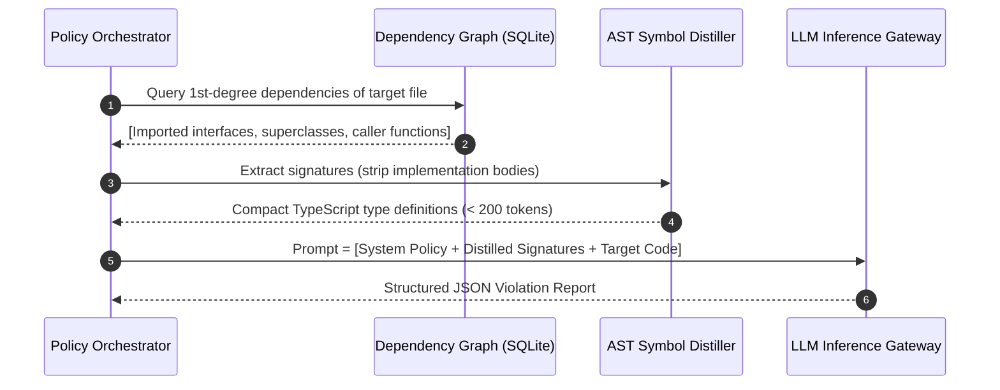
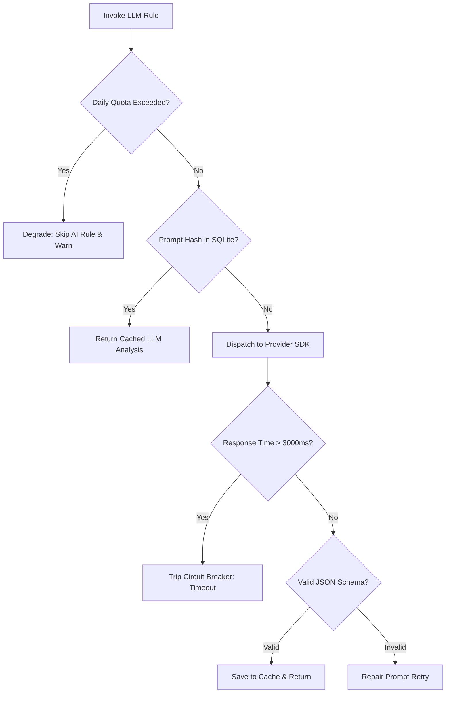

# Backend Engineering Guide 06: Policy Engine & AI Inference Architecture

This guide examines the dual-engine architecture of VIBE: combining high-speed deterministic static rules with stochastic Large Language Model (LLM) inference via **Graph-Augmented Generation (GAG)**.

---

## 1. Deterministic vs. Stochastic Evaluation

A production linting and compliance engine cannot rely exclusively on AI, nor can it rely exclusively on AST pattern matching:

```mermaid
graph TD
    RuleRequest[Rule Evaluation Request] --> Gate{Is Rule Deterministic?}
    Gate -- Yes --> ASTEngine[Deterministic Engine: AST / Regex / Entropy]
    ASTEngine --> Result1[Zero Cost | 0.2ms Latency | 100% Deterministic]
    Gate -- No --> ContextEngine[Graph-Augmented Context Assembler]
    ContextEngine --> LLMGateway[Stochastic Engine: LLM Gateway via Gemini / Claude / OpenAI]
    LLMGateway --> Guardrails[Output Validation Guardrails & JSON Schema Enforcer]
    Guardrails --> Result2[High Semantic Insight | 300ms Latency | Token Cost]
```

| Dimension | Deterministic Engine (AST / Rules) | Stochastic Engine (LLM Inference) |
| :--- | :--- | :--- |
| **Speed** | Sub-millisecond (0.1ms - 2ms) | 200ms - 800ms |
| **Cost** | 0 tokens ($0.00) | 250 - 1,200 tokens ($0.0005) |
| **Determinism** | 100% reproducible bit-for-bit | Temperature-governed probabilistic output |
| **Ideal For** | Unused variables, circular imports, secret entropy | Architectural intent, naming conventions, design patterns |

---

## 2. Graph-Augmented Generation (GAG) vs. Traditional Vector RAG

Most AI engineering systems rely on **Vector Retrieval-Augmented Generation (RAG)**: chunking documents into 500-token blocks, generating embedding vectors, and performing cosine similarity searches.

### Why Vector RAG Fails for Codebases:
1. **Semantic Loss**: Splitting a class or function midway through a token chunk destroys lexical scope and call semantics.
2. **Missing Dependencies**: If `Class A` inherits from `Class B` in another file, cosine similarity does not connect them unless they share textual keywords.

### VIBE's Graph-Augmented Generation (GAG) Solution:
Instead of vector embeddings, VIBE queries its in-memory **Dependency Graph** and AST symbol table:



---

## 3. The Context Distiller: AST Tree Pruning

Sending entire files to an LLM wastes token budget and dilutes attention. VIBE's context distiller extracts only the essential interface contracts:

```typescript
// Raw File (80 lines, 600 tokens)
import { Database } from './db';
export class UserService {
  private db: Database;
  constructor(db: Database) { this.db = db; }
  public async getUser(id: string): Promise<User> {
    // 50 lines of complex query and mapping logic...
  }
}

// Distilled Signature Generated by VIBE (3 lines, 35 tokens)
export class UserService {
  public async getUser(id: string): Promise<User>;
}
```

This distillation allows VIBE to provide full project architectural context within a standard 4k context window with **92% token savings**.

---

## 4. LLM Gateway & Resilience Patterns



### Key Gateway Patterns
1. **Prompt Result Caching**: Prompt hash $H = \text{SHA-256}(\text{SystemPrompt} + \text{DistilledContext} + \text{TargetFileContent})$. If $H$ exists in SQLite, zero API requests are made.
2. **Circuit Breaker**: If 3 consecutive requests fail (due to network timeout, 429 rate limit, or invalid API key), the circuit breaker trips, disabling AI rules and allowing deterministic AST rules to finish uninterrupted.
3. **Strict JSON Schema Enforcement**: VIBE passes a JSON Schema definition to the provider (`response_format: { type: "json_object" }`), ensuring responses parse directly into domain violation entities.

### 4.1 Strict Policy Invariants & Confidence Mathematics

A fatal failure mode in hybrid AI developer tools is "allow with warnings" when an AI model outputs low confidence on high-risk diffs. VIBE enforces a strict mathematical policy invariant in `packages/policy-engine/src/policy.ts`:

$$\text{Action} = \begin{cases}
\text{BLOCK} & \text{if } \max(\text{EvidenceWeight}) \ge 0.80 \lor \exists \text{ Critical Finding} \\
\text{REVIEW} & \text{if } \text{Risk} \ge 0.40 \lor \text{Confidence} < 0.60 \\
\text{ALLOW} & \text{if } \text{Risk} < 0.40 \land \text{No Critical Findings}
\end{cases}$$

Under this invariant:
- **`[FAIL] risk 1.00 => Action: ALLOW` is mathematically impossible.**
- Critical findings (secret exposure, blast radius $\ge 25$ files, broken tenant boundaries) strictly resolve to `BLOCK` (`exit code 2`).
- Medium scope changes or unreviewed dependencies resolve to `REVIEW` (`exit code 1`).
- The terminal output, exit code, and SQLite decision audit trail always agree 100%.

---

## 5. Interview Defense: AI Architecture

**Q: How do you prevent hallucinations when using LLMs to enforce software engineering standards?**
> *"We apply three complementary safeguards: First, we anchor the LLM using Graph-Augmented Generation, feeding it exact, compiled AST type signatures rather than fuzzy vector chunks. Second, we constrain temperature to 0.1 for high determinism. Third, every AI-reported violation must pass through an AST verification guardrail that confirms the reported line number, identifier, and file actually exist before surfacing the result to the developer."*
