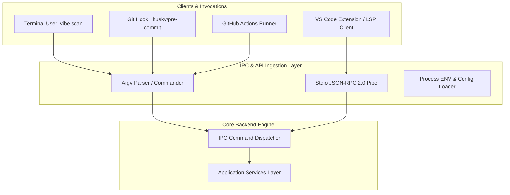

# Backend Engineering Guide 07: API & IPC Contracts Architecture

This guide covers the communication protocols, Inter-Process Communication (IPC) contracts, and error serialization standards implemented across VIBE.

---

## 1. IPC Channels & Protocols

VIBE operates across multiple execution environments: standalone CLI invocation, git pre-commit hooks, IDE Language Server Protocol (LSP) daemon processes, and CI automated pipelines.



---

## 2. Standardized JSON-RPC 2.0 Protocol (LSP Mode)

When acting as an IDE background service, VIBE communicates via bidirectional **JSON-RPC 2.0** over standard input/output streams (`stdio`):

### Request Contract
```json
{
  "jsonrpc": "2.0",
  "id": "req-1042",
  "method": "vibe/analyzeFile",
  "params": {
    "uri": "file:///workspace/src/auth/token.ts",
    "content": "export const SECRET = 'sk_live_948123';",
    "options": {
      "stagedOnly": false,
      "severityThreshold": "warn"
    }
  }
}
```

### Success Response Contract
```json
{
  "jsonrpc": "2.0",
  "id": "req-1042",
  "result": {
    "status": "completed",
    "scannedFiles": 1,
    "violations": [
      {
        "ruleId": "SEC-001",
        "severity": "error",
        "message": "High-entropy API key detected in plaintext literal.",
        "file": "src/auth/token.ts",
        "line": 1,
        "column": 23,
        "suggestion": "Migrate to process.env.SECRET or vault reference."
      }
    ],
    "durationMs": 4.2
  }
}
```

---

## 3. Standard Exit Code Semantics

For terminal, git pre-commit hooks, and CI/CD pipeline consumption, VIBE maps backend execution states to standard 4-state POSIX-compliant exit codes:

| Exit Code | Action | Semantic Meaning & Invariant | CI Pipeline / Git Action |
| :---: | :---: | :--- | :--- |
| **`0`** | **`ALLOW`** | **Clean / Safe** — No findings or low evidence risk ($< 0.40$). | Pipeline passes; pre-commit allows commit. |
| **`1`** | **`REVIEW`** | **Review Recommended** — Moderate risk ($\ge 0.40, < 0.80$) or dependency warnings. | Pipeline generates PR review request; pre-commit prompts for confirmation. |
| **`2`** | **`BLOCK`** | **Hard Block** — Critical findings, leaked secrets, broken tenant boundaries, or evidence weight $\ge 0.80$. | Pipeline FAILS; pre-commit aborts commit immediately. |
| **`3`** | **`ERROR`** | **Execution / Config Error** — Missing repository, corrupt state, or internal failure. | Pipeline fails with execution error. |

### 3.1 SARIF v2.1.0 Protocol for CI/CD Gates
When invoked with `-f sarif`, VIBE emits standard OASIS SARIF v2.1.0 schema logs that stream directly into GitHub Security, GitLab SAST, or Azure DevOps:
```bash
vibe guard -b ci-merge-base -f sarif > vibe-report.sarif
vibe doctor -f sarif > doctor-report.sarif
```

---

## 4. The Standard Error Envelope

Any failure across the CLI, IPC, or API boundary produces a strictly serialized error envelope:

```typescript
export interface ErrorEnvelope {
  success: false;
  error: {
    code: string;               // e.g. 'ERR_SQLITE_BUSY', 'ERR_AST_PARSE_FAILURE'
    message: string;            // Human-readable summary
    details?: unknown;          // Granular debug payload
    stack?: string;             // Omitted in production unless --verbose
    timestamp: string;          // ISO 8601 UTC
    traceId: string;            // Correlation ID for log lookup
  };
}

export function createErrorEnvelope(code: string, message: string, traceId: string, details?: unknown): ErrorEnvelope {
  return {
    success: false,
    error: {
      code,
      message,
      details,
      timestamp: new Date().toISOString(),
      traceId
    }
  };
}
```

---

## 5. Streaming Event Protocol for Long-Running Operations

For large multi-thousand-file repositories, waiting for a single synchronous response causes UI freezes and timeouts. VIBE utilizes **Newline-Delimited JSON (ndjson)** event streaming:

```json
{"event": "start", "totalFiles": 1420, "timestamp": 1718000000}
{"event": "progress", "completedFiles": 350, "currentFile": "src/db/pool.ts"}
{"event": "violation", "file": "src/db/pool.ts", "rule": "PERF-003", "severity": "warn"}
{"event": "complete", "totalViolations": 1, "durationMs": 842.1}
```

This streaming design enables the terminal CLI to render 60fps Ink progress spinners while IDE extensions dynamically update file diagnostic markers in real time.
