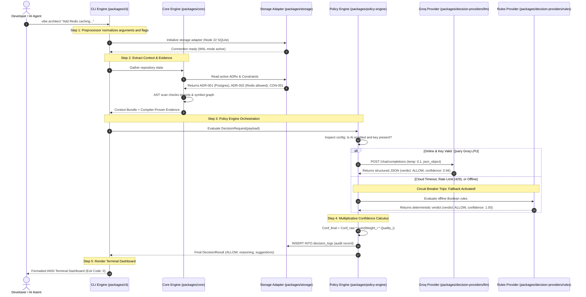

# 03. System Architecture & The Ports and Adapters Mental Model
**Document**: `docs/03-system-architecture.md`  
**System**: VIBE (Vibe Intent & Boundary Engine)  
**Perspective**: The Chief Architect's Blueprint & Structural Deep-Dive

---

## 3.1 The Architectural Philosophy: Ports and Adapters (Hexagonal Architecture)
Most developer tools start as a single messy script. The author puts the CLI commands, the git calls, the database queries, and the LLM API calls all in one file. 

Then things start breaking:
- You want to test the decision reasoning, but it tries to make a real HTTP call to Groq and fails in CI.
- You want to support SQLite, but your teammate's computer doesn't have Python installed to compile `better-sqlite3`.
- You want to run the core engine inside a VS Code extension, but your CLI logic has `process.exit(1)` hardcoded everywhere, crashing the entire VS Code editor process.

To build VIBE for enterprise-grade reliability, we adopted **Hexagonal Architecture (Ports and Adapters)**:

```
                  ┌────────────────────────────────────────────────────────┐
                  │                 PRESENTATION CLIENTS                   │
                  │  CLI (Commander.js)  │  VS Code Extension  │ Git Hook  │
                  └───────────────────────────┬────────────────────────────┘
                                              │
                                              ▼
                  ┌────────────────────────────────────────────────────────┐
                  │            @vibe/core (Deterministic Engine)           │
                  │  TypeScript AST Scanner │ In-Memory DAG │ BFS Blast    │
                  │  Shannon Entropy Secret Guard │ Staged Git Plumbing    │
                  └───────────────────────────┬────────────────────────────┘
                                              │
                                              ▼
                  ┌────────────────────────────────────────────────────────┐
                  │        @vibe/decision-core (Universal Contracts)       │
                  │     "THE PORT" (Pure Types, Zero External Deps)        │
                  │   DecisionRequest │ DecisionResult │ DecisionProvider  │
                  └───────────────────────────┬────────────────────────────┘
                                              │
                                              ▼
                  ┌────────────────────────────────────────────────────────┐
                  │       @vibe/policy-engine (Confidence Calculus)        │
                  │   Weighted Evidence Scoring │ Circuit-Breaking Chain   │
                  └───────────────┬────────────────────────┬───────────────┘
                                  │                        │
                      "ADAPTER 1" │            "ADAPTER 2" │
                                  ▼                        ▼
                  ┌────────────────────────┐  ┌────────────────────────────┐
                  │ @vibe/decision-        │  │ @vibe/decision-            │
                  │ providers/llm          │  │ providers/rules            │
                  │ Groq Cloud LPU Client  │  │ Zero-Network Deterministic │
                  │ (Low Temp, Strict JSON)│  │ Static Rule Evaluator      │
                  └────────────────────────┘  └────────────────────────────┘
                                              │
                                              ▼
                  ┌────────────────────────────────────────────────────────┐
                  │          @vibe/storage (Unified Persistence)           │
                  │   Node 22 Native SQLite (WAL) │ Atomic JSON Adapter    │
                  └────────────────────────────────────────────────────────┘
```

### The Wall Socket Analogy
Think of `@vibe/decision-core` as an electrical wall socket (the Port). It defines the exact shape of the plug: `DecisionRequest` goes in, `DecisionResult` comes out.

- **The Groq LLM Provider** is a high-speed electric car charger that plugs into the socket. It uses AI, runs on Groq's cloud LPUs, and reasons over complex architectural context.
- **The Deterministic Rules Provider** is a battery backup that plugs into the exact same socket. It requires zero electricity (zero network), evaluates static Boolean truth tables, and executes in 1 millisecond.

The core engine does not know or care which provider is plugged in. If the cloud charger loses power (network timeout or rate limit), the system instantly switches to the battery backup without dropping a single packet.

---

## 3.2 Monorepo Topology: Why 7 Decoupled Packages?
VIBE is organized as an npm monorepo with 7 isolated packages. Every single package has a strict, single-direction dependency flow:

```
packages/decision-core (Independent Domain Contracts)
          ▲
          │ depends on
packages/core ────► packages/decision-providers/rules
          ▲                ▲
          │                │
packages/policy-engine ────┴─► packages/decision-providers/llm
          ▲
          │
packages/storage
          ▲
          │
packages/cli ◄──── packages/vscode-extension (Decoupled IPC)
```

| Package Name | Physical Path | Core Responsibility | External Dependencies |
| :--- | :--- | :--- | :--- |
| `@vibe/decision-core` | `packages/decision-core` | Pure domain contracts, interfaces, enums | **Zero** (Pure TypeScript) |
| `@vibe/core` | `packages/core` | AST traversal, DAG construction, Git diffs, entropy secret scanning, blast radius | `typescript`, `simple-git` |
| `@vibe/decision-providers/rules` | `packages/decision-providers/rules` | Sub-millisecond deterministic static rule evaluation | `@vibe/decision-core` |
| `@vibe/decision-providers/llm` | `packages/decision-providers/llm` | Cloud Groq LPU inference with low temperature and strict JSON output | `groq-sdk`, `@vibe/decision-core` |
| `@vibe/policy-engine` | `packages/policy-engine` | Multiplicative confidence calculus, policy matrix, fallback circuit breaker | `@vibe/decision-core` |
| `@vibe/storage` | `packages/storage` | Node 22 native SQLite adapter, atomic JSON adapter, migration engine | `node:sqlite`, `@vibe/core`, `@vibe/decision-core` |
| `@vibe/cli` | `packages/cli` | Commander CLI, argument preprocessor, 25+ commands, Git hooks | `commander`, `chalk`, `cli-spinners` |
| `@vibe/vscode-extension` | `packages/vscode-extension` | IDE sidebar UI, 4 TreeDataProviders, OS FileSystemWatcher, non-blocking IPC | `vscode` |

---

## 3.3 The Low-Level Request-Response Lifecycle
What actually happens inside the Node.js V8 engine when a user types:
`vibe architect "Add Redis caching to user profile route"`?

Let's trace it step-by-step:



---

## 3.4 Key Architectural Invariants (The Non-Negotiable Rules)
1. **Zero Circular Monorepo Imports**: Monorepo packages can only import downwards in the dependency tree. `decision-core` cannot import `core`; `core` cannot import `cli`.
2. **Deterministic Truth Trumps AI Opinion**: An LLM can never override a compiler-proven fact. If the TypeScript compiler proves that a circular import exists, an LLM saying *"it looks fine to me"* is mathematically rejected by our confidence calculus.
3. **Non-Blocking IDE Extension**: The VS Code extension host must never run heavy AST graph traversals on the main thread. It spawns CLI child processes asynchronously via `child_process.execFile`, keeping the editor running smoothly at 60 FPS.
4. **Resilient Local Storage**: The system must persist state without external database servers. Node 22 native SQLite provides enterprise-grade ACID transactions directly in-process.

---

## 3.5 How to Defend This Architecture in an Interview
When an interviewer asks: *"Walk me through the system architecture of your project and defend your structural choices."*

> *"I structured VIBE around Hexagonal Architecture (Ports and Adapters) across 7 decoupled packages in a monorepo.
>
> At the center is `@vibe/decision-core`, which contains pure domain interfaces with zero external dependencies. This decoupling allowed me to build a hybrid inference engine: the Policy Engine coordinates a cloud Groq LPU adapter for nuanced natural language reasoning, and an offline deterministic rule adapter for sub-millisecond static checks. Both plug into the exact same port.
>
> When an architectural proposal is evaluated, the Policy Engine runs a fallback chain with confidence calculus. If Groq times out or encounters rate limits, the circuit breaker trips and falls back to our offline rules provider without crashing.
>
> For data storage, I implemented a unified storage port with a primary Node 22 native SQLite adapter configured in WAL mode for non-blocking concurrent reads, backed by an atomic POSIX-rename JSON adapter as a fallback for older environments.
>
> Finally, the presentation layer is split into a Commander CLI and a reactive VS Code extension that uses native OS kernel FileSystemWatcher events to update TreeViews without resource-heavy polling."*
