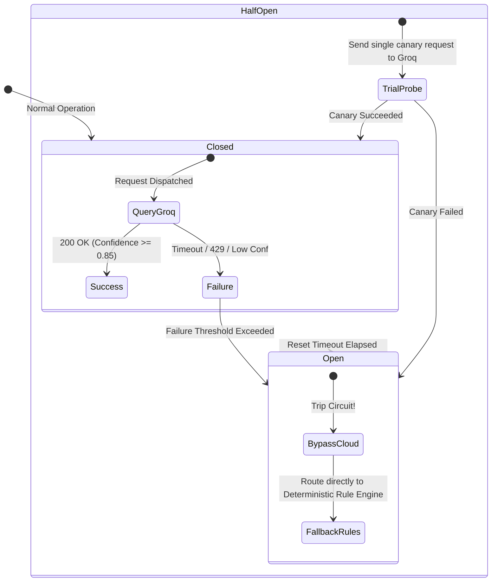

# 12. Distributed Systems Concepts & Fault Tolerance in Developer Tooling
**Document**: `docs/12-distributed-systems.md`  
**System**: VIBE (Vibe Intent & Boundary Engine)  
**Perspective**: Architecture Trade-offs, Circuit Breakers, Exponential Backoff & Consistency Models

---

## 12.1 The Engineering Truth: Don't Build Distributed Systems You Don't Need
One of the most common signs of an inexperienced engineer is designing a distributed microservices system for a problem that runs best as an in-process modular monolith.

If VIBE had been designed with a microservices architecture—running a separate Docker container for the AST parser, a Redis cluster for queues, and a Kafka broker for events:
- Booting the system would take 15 seconds.
- Memory usage would jump from 28MB to 2GB.
- Network serialization overhead (JSON/gRPC over localhost sockets) would destroy our 120ms pre-commit latency budget.

### The Architectural Choice: A Modular Monolith
VIBE is built as an **in-process modular monolith**. 
- Functions communicate through typed in-process calls.
- Latency between modules is **0.0001 milliseconds** (pointer dereference), not 5ms over TCP/HTTP.
- Garbage collection is unified within the V8 runtime.

**However**, VIBE applies core distributed systems principles to handle unreliable external cloud dependencies and govern distributed microservice repositories.

---

## 12.2 The Circuit Breaker Pattern: Protecting Against Cloud LLM Outages
When evaluating architectural decisions (`vibe architect`), VIBE queries the Groq Cloud LPU API.

What happens if Groq suffers an outage, an internet cable is cut, or the developer hits a 429 Rate Limit?
- Without a circuit breaker, the CLI hangs for 30 seconds waiting for an HTTP timeout, frustrating the user.

VIBE implements a **Three-State Circuit Breaker** in `@vibe/policy-engine`:

### The Circuit Breaker States:
1. **CLOSED (Normal)**: All architectural evaluations query Groq LPUs for structured reasoning.
2. **OPEN (Tripped)**: If 3 consecutive requests time out or fail, the circuit trips. The system **does not even attempt network calls**. It routes immediately to the offline Deterministic Rule Engine in $< 1.5\text{ ms}$.
3. **HALF-OPEN (Canary Probe)**: After a cooldown period (60 seconds), the engine sends a single canary request to test if cloud connectivity has recovered. If it succeeds, the circuit closes; if it fails, it returns to OPEN.

---

## 12.3 Exponential Backoff with Jitter: Preventing the Thundering Herd
When an external API returns HTTP 429 (Too Many Requests), a naive retry loop retries immediately:
`for (let i = 0; i < 3; i++) { retry(); }`

### Why Naive Retries Cause Cascading Outages:
If 50 developers in an enterprise are committing code simultaneously and the cloud API has a temporary spike, all 50 CLI instances retry at the exact same millisecond. This creates a **Thundering Herd** that guarantees the API stays overwhelmed.

### VIBE's Solution: Exponential Backoff with Full Random Jitter
$$\text{Delay}(n) = \min\left(\text{MaxDelay}, \text{random}(0, \text{Base} \times 2^n)\right)$$

Where:
- $\text{Base} = 200\text{ ms}$
- $n$ is the retry attempt ($0, 1, 2$).
- $\text{random}(0, \dots)$ spreads retries across a randomized window, smoothing the traffic curve and allowing the cloud API to recover.

---

## 12.4 Strong vs. Eventual Consistency in Developer Tools
In distributed cloud databases (like DynamoDB or Cassandra), systems often embrace **Eventual Consistency**: you write a record, and a few seconds later, other read replicas see it.

### Why Eventual Consistency is Unacceptable for VIBE:
Imagine a developer runs:
1. `vibe adr add "Auth Engine" -d "Use OAuth2"`
2. `git commit -m "Add auth logic"`

If VIBE used an eventually consistent storage engine or background queue, the pre-commit hook in step 2 might read stale state that doesn't yet contain the newly added ADR! It would block the commit with a false-positive violation!

### VIBE Enforces Strict Immediate Consistency:
- SQLite Write-Ahead Logging commits synchronously to disk before the CLI process exits.
- When `vibe adr add` finishes, the record is guaranteed to be on physical disk. Step 2 reads the verified state with $100\%$ consistency.

---

## 12.5 How to Defend This in an Interview
When an interviewer asks: *"Did you consider microservices for this architecture, and how do you handle distributed failure modes?"*

> *"I deliberately chose an in-process modular monolith rather than microservices. For a developer CLI where sub-120ms latency and minimal memory footprint are top priorities, introducing inter-process network hops or container orchestration would add pure overhead.
>
> However, I applied distributed systems resiliency patterns at the boundaries. For external cloud AI inference with Groq, I implemented a Three-State Circuit Breaker in `@vibe/policy-engine`. If cloud calls encounter network partitions, 429 rate limits, or timeouts, the circuit trips and routes execution immediately to our offline deterministic rule engine.
>
> To avoid the Thundering Herd problem during cloud API retries, I implemented exponential backoff with full randomized jitter.
>
> And for data storage, I rejected eventual consistency in favor of strict ACID serializability using SQLite WAL mode, ensuring that sequential CLI commands always read consistent, uncorrupted state."*
