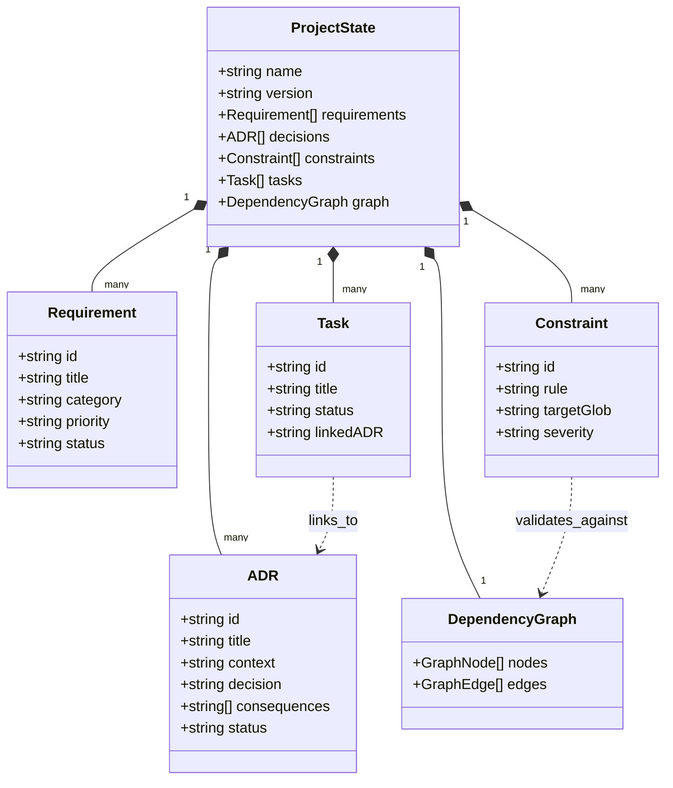

# Phase 1: Product & Requirements Engineering
**Document Ref**: `docs1/01-phase1-product-requirements.md`  
**System**: VIBE (Vibe Intent & Boundary Engine)  
**Phase**: Phase 1 of 10 — High-Level Connectivity & Product Foundation

---

## Executive Overview: The Intent of Phase 1
Before writing a single line of backend code, an architect must establish **what** is being built, **why** it matters, and **who** it serves. In VIBE, this phase bridges human product intent with compiler-level automation.

---

## 1. Product Engineering
*Product vision, target users, value proposition, business requirements.*

### 1.1 Product Vision
To establish an autonomous, compiler-backed control plane for modern software development—guaranteeing that code produced by human engineers or autonomous AI coding agents adheres to architectural invariants, security boundaries, and codified team decisions before reaching version control.

### 1.2 Target Users
1. **Senior & Staff Software Engineers**: Automate architectural governance and prevent layer violations.
2. **Engineering Leads & CTOs**: Maintain living, auditable Architectural Decision Records (ADRs) and prevent compounding technical debt.
3. **AI Coding Agents (Cursor, Copilot, Claude Code, Devin)**: Receive machine-readable context packs (`vibe context`) that constrain generation within valid architectural boundaries.
4. **DevOps & Security Engineers**: Prevent credential leaks and enforce compliance at the local workstation before Git push.

### 1.3 Core Value Proposition
- **Zero Architectural Drift**: Code is continuously verified against codified ADRs and constraints.
- **Sub-120ms Pre-Commit Gate**: Instant static verification that never slows down developer flow.
- **Deterministic Trust**: Probabilistic LLM outputs are validated by compiler-proven facts through mathematical confidence calculus.
- **Zero-Dependency Native Storage**: Seamless npm installation without C++ compilation errors (`node-gyp`).

### 1.4 Business Requirements
- Reduce PR review cycles by automating static architectural checks.
- Eliminate high-entropy credential leakage in remote Git repositories.
- Maintain immutable, SOC2-compliant audit trails of all architectural decisions.

---

## 2. Requirements Engineering
*Functional requirements, non-functional requirements, user stories, acceptance criteria.*

### 2.1 Functional Requirements (FR)
- **FR-01 (Workspace Bootstrapping)**: Initialize `.vibe/` metadata, configuration, and SQLite database with a single command (`vibe init`).
- **FR-02 (AST Parsing & Graph Construction)**: Traverse TypeScript/JavaScript source files, extract imports, exports, functions, classes, and types, and construct a directed dependency graph (`vibe scan`).
- **FR-03 (Cycle Detection)**: Detect circular dependencies using 3-color DFS graph traversal and report exact cyclic chains.
- **FR-04 (Blast Radius Calculation)**: Compute downstream dependent files affected by staged git changes using reverse BFS graph reachability (`vibe impact`).
- **FR-05 (Secret & Entropy Guard)**: Intercept high-entropy strings ($H \ge 4.5$) and matched credential signatures in staged git hunks (`vibe guard`).
- **FR-06 (ADR Management)**: Maintain structured Architectural Decision Records with context, decision, consequences, and lifecycle state (`vibe adr add|list|remove`).
- **FR-07 (Constraint Enforcement)**: Enforce glob-scoped boundary rules and flag architectural violations (`vibe constraint add|list|remove`).
- **FR-08 (Decision Inference)**: Evaluate architectural proposals against active ADRs and constraints using Groq LLM inference, falling back to deterministic rules if offline (`vibe architect`).
- **FR-09 (Git Pre-Commit Hook)**: Install an executable git hook that blocks commits violating constraints or exposing secrets (`vibe hooks install`).
- **FR-10 (IDE Visualization)**: Render live reactive trees in VS Code for Requirements, Decisions, Constraints, and Tasks.

### 2.2 Non-Functional Requirements (NFR)
- **Latency Budget**: Staged pre-commit gate checks must execute in $< 120\text{ ms}$.
- **Network Autonomy**: 100% of core governance, scanning, and rule evaluation must run offline.
- **Reliability & ACID Safety**: Synchronous disk commits with WAL mode in SQLite; atomic POSIX temporary-file renames for JSON fallback.
- **Zero-Native-Build Install**: $100\%$ install success rate across Windows, macOS, and Linux by leveraging Node 22 native `node:sqlite`.
- **Memory Footprint**: Background VS Code extension memory consumption $< 35\text{ MB}$.

### 2.3 User Stories & Acceptance Criteria
- *Story*: "As a developer, I want my pre-commit hook to block accidental API key commits so that I don't expose credentials to GitHub."
  - *Acceptance Criterion*: Staging an AWS secret key (`AKIA...`) and running `git commit` aborts the commit with exit code `2` (`BLOCK`) and prints the exact file and line number within 110ms. Warnings exit with `1` (`REVIEW`) and clean runs with `0` (`ALLOW`).
- *Story*: "As a tech lead, I want to forbid UI components from importing backend database drivers."
  - *Acceptance Criterion*: Running `vibe con add "No direct DB calls from UI" -t "src/components/**"` causes any commit with `import { pg } from 'pg'` in `src/components/` to be blocked.

---

## 3. Domain Modeling
*Business entities, domain boundaries, workflows, relationships.*



---

## 4. Product & Feature Specification
*Module breakdown, feature dependencies, user journeys, feature prioritization.*

### 4.1 Feature Breakdown & Dependencies
1. **Core Scanning (`@vibe/core`)**: Required by all higher-level features. Parses AST and builds the in-memory dependency graph.
2. **Safety Gate (`guard.ts` & `impact.ts`)**: Depends on AST scanner and Git diff plumbing. Computes blast radius and secret entropy.
3. **Governance Management (`decisions.ts`, `requirements.ts`)**: Manages the lifecycle of ADRs, constraints, and tasks.
4. **Hybrid Decision Intelligence (`@vibe/policy-engine`)**: Depends on `@vibe/decision-core` and governance state. Evaluates proposals.
5. **Presentation Clients (`@vibe/cli`, `@vibe/vscode-extension`)**: User-facing interfaces consuming core and policy engines.

### 4.2 The Developer User Journey
```
vibe init ──► vibe scan ──► vibe adr add ──► vibe hooks install ──► Daily Coding (Protected)
```

---

## 5. UX Research & Interaction Design
*User personas, wireframes, workflows, usability.*

### 5.1 Persona Profiles
- **The Speed-Oriented Developer**: Rejects any tool that pauses their terminal for more than 1 second. Demands sub-150ms verification.
- **The Staff Architect**: Demands transparency; needs to know *why* an AI decision was approved or blocked (`vibe why <id>`).

### 5.2 Terminal UI & IDE UX Design
- **Terminal Design**: Clean ANSI color formatting (Green checkmarks, Red error blocks, Yellow warnings). Zero decorative spam in machine mode (`--json`).
- **IDE Sidebar UX**: Seamless integration into VS Code Activity Bar (`vibe-sidebar`) with 4 native TreeViews and zero timer polling.
