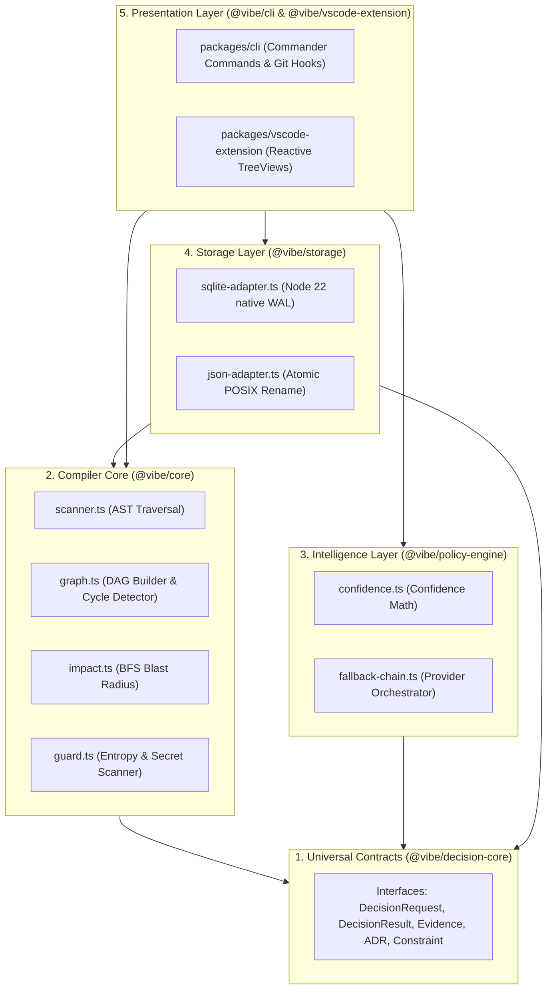
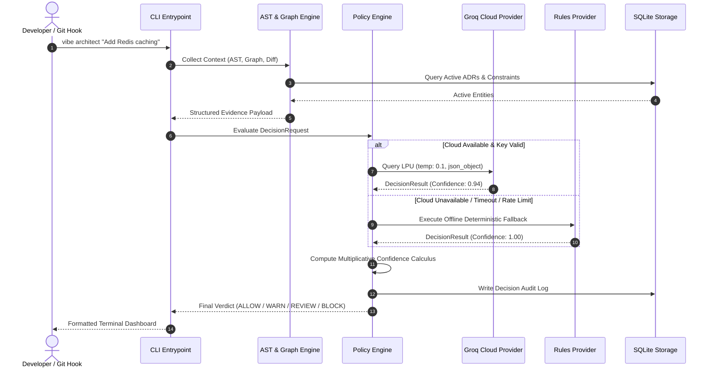

# Phase 2: Architecture & System Design
**Document Ref**: `docs1/02-phase2-architecture-system-design.md`  
**System**: VIBE (Vibe Intent & Boundary Engine)  
**Phase**: Phase 2 of 10 — Structural Engineering & System Topologies

---

## Executive Overview: The Intent of Phase 2
Phase 2 establishes how the entire application is structured, how modules communicate, how data flows, and how the system guarantees resilience and performance.

---

## 6. Software Architecture
*Monolith, modular monolith, microservices, layered architecture, clean architecture, hexagonal architecture.*

### 6.1 Architectural Style: Hexagonal (Ports & Adapters)
VIBE is architected around **Hexagonal Architecture (Ports and Adapters)**. Core domain contracts and business entities are completely isolated from storage backends, cloud providers, and presentation interfaces.

```
                      [Presentation Ports]
                  CLI Engine  │  VS Code Extension
                              │
                              ▼
                   ┌──────────────────────┐
                   │     @vibe/core       │
                   │ Deterministic Engine │
                   └──────────┬───────────┘
                              │
                              ▼
                ┌───────────────────────────┐
                │    @vibe/decision-core    │
                │  "THE PORT" (Pure Types)  │
                └─────────────┬─────────────┘
                              │
                              ▼
                   [Pluggable Adapters]
             Groq LPU LLM  │  Offline Rules Engine
             Node 22 SQLite│  Atomic JSON Storage
```

### 6.2 Why a Modular Monolith Over Microservices?
- **In-Process Speed**: Inter-module communication executes via direct in-process function calls ($0.0001\text{ ms}$ latency), completely avoiding HTTP/gRPC serialization overhead.
- **Zero Daemon Overhead**: Operates without background server processes, consuming **0MB RAM when idle**.
- **Package Isolation**: Monorepo with 7 isolated npm workspaces guarantees that domain contracts, compiler analysis, storage, and UI can be developed and tested independently.

---

## 7. System Design (HLD & LLD)
*High-level design, low-level design, scalability, availability, reliability.*

### 7.1 High-Level Design (HLD)
The system connects three primary operational tiers:
1. **The Ingestion & Analysis Tier**: TypeScript Compiler API parses source code syntax trees; `simple-git` extracts staged git diffs.
2. **The Decision Intelligence Tier**: Policy Engine runs a fallback chain coordinating cloud Groq LPUs with local deterministic rule evaluation.
3. **The Unified Persistence Tier**: Node 22 native `node:sqlite` stores state, graph snapshots, and decision audit logs with WAL mode concurrency.

### 7.2 Low-Level Design (LLD)
- **Scanner Subsystem**: Calls `ts.createSourceFile` with `setParentNodes = false` to eliminate memory-heavy circular parent pointers.
- **Graph Subsystem**: Maps source files to `GraphNode` records and import statements to `GraphEdge` records using adjacency lists.
- **Circuit Breaker Subsystem**: Three-state state machine (Closed, Open, Half-Open) managing fallback from Groq to deterministic rules.

---

## 8. Component & Module Architecture
*Module boundaries, dependencies, interfaces, separation of concerns.*



---

## 9. Distributed Systems Design
*Service communication, consistency, fault tolerance, distributed transactions.*

### 9.1 Strong Consistency in Local Workstations
Unlike eventually consistent distributed databases, developer governance requires **Immediate Serializability**:
- All state mutations commit synchronously inside SQLite transactions before a command exits.
- If a developer runs `vibe adr add` and immediately executes `git commit`, the pre-commit hook is guaranteed to read the freshly committed ADR.

### 9.2 Circuit Breaker & Exponential Backoff
- When querying Groq Cloud LPUs, network errors or HTTP 429 status codes trigger a 3-attempt retry loop with **exponential backoff and randomized jitter**:
  $$\text{Delay} = \min(\text{MaxDelay}, \text{random}(0, \text{Base} \times 2^n))$$
- If failures persist, the circuit trips (`OPEN`), redirecting all evaluations to the offline deterministic rules provider.

---

## 10. Data Flow Architecture
*Request lifecycle, event flows, state transitions, inter-service communication.*



---

## 11. Infrastructure Architecture
*Cloud architecture, networking, compute, storage, environments.*

### 11.1 Workstation Compute & Storage
- **Compute**: Runs within the local Node.js V8 execution context on the developer's CPU.
- **Storage**: In-process SQLite database stored at `.vibe/vibe.db`, requiring $< 10\text{ MB}$ disk space per project.

### 11.2 Cloud Edge Compute (Groq LPUs)
- **Network Protocol**: TLS 1.3 HTTPS outbound requests to `https://api.groq.com/openai/v1`.
- **Compute Architecture**: Tensor Streaming Processor (TSP) LPUs with 230MB on-die SRAM per chip, executing token generation at $> 500\text{ tokens/second}$.
