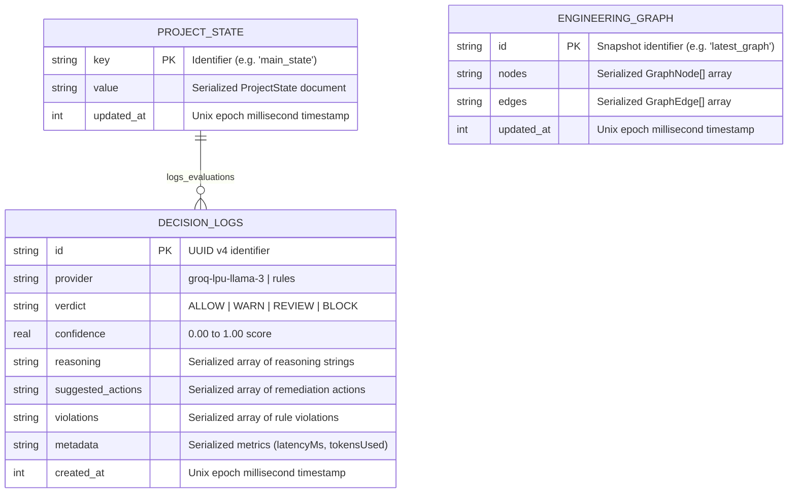

# Phase 5: Database & Data Engineering
**Document Ref**: `docs1/05-phase5-database-data-engineering.md`  
**System**: VIBE (Vibe Intent & Boundary Engine)  
**Phase**: Phase 5 of 10 — Persistence, Schemas, Transactions & Migrations

---

## Executive Overview: The Intent of Phase 5
Phase 5 covers how information is structured, stored, queried, and maintained: the Node 22 native SQLite engine, relational schemas, B-tree indexes, ACID transactions, WAL mode concurrency, and atomic JSON fallback persistence.

---

## 26. Database Architecture
*Relational vs NoSQL, database selection, database boundaries.*

### 26.1 Selection: Node 22 Native SQLite (`node:sqlite`)
Traditional Node.js SQLite addons (`better-sqlite3`, `sqlite3`) require compiling C++ binaries using `node-gyp` and Python, causing installation failures on machines without Visual Studio C++ build tools.

VIBE selects **Node 22 native `node:sqlite` (`DatabaseSync`)**:
- Pre-compiled directly into the Node 22 binary by the Node.js core team.
- **Zero build dependencies**: No Python, no C++ compilers.
- **Native C-Speed**: Direct V8-to-C bindings with zero IPC overhead.
- **ACID Transactions**: Full transactional safety with rollback support.

---

## 27. Database Schema Design
*Tables, collections, relationships, normalization, denormalization.*

```sql
-- packages/storage/src/sqlite-adapter.ts

-- 1. Project State & Configuration
CREATE TABLE IF NOT EXISTS project_state (
    key TEXT PRIMARY KEY,
    value TEXT NOT NULL,
    updated_at INTEGER NOT NULL
);

-- 2. Immutable Decision Audit Trail
CREATE TABLE IF NOT EXISTS decision_logs (
    id TEXT PRIMARY KEY,
    provider TEXT NOT NULL,
    verdict TEXT NOT NULL CHECK (verdict IN ('ALLOW', 'WARN', 'REVIEW', 'BLOCK')),
    confidence REAL NOT NULL,
    reasoning TEXT NOT NULL,
    suggested_actions TEXT NOT NULL,
    violations TEXT NOT NULL,
    metadata TEXT NOT NULL,
    created_at INTEGER NOT NULL
);

-- 3. Cached Dependency Graph
CREATE TABLE IF NOT EXISTS engineering_graph (
    id TEXT PRIMARY KEY,
    nodes TEXT NOT NULL,
    edges TEXT NOT NULL,
    updated_at INTEGER NOT NULL
);
```

---

## 28. Data Modeling
*Entity relationships, ER diagrams, domain entities, constraints.*



---

## 29. Database Engineering
*Queries, indexes, aggregations, transactions, connection management.*

### 29.1 Prepared Statements & B-Tree Indexes
All queries in `sqlite-adapter.ts` use prepared statements with parameter binding:
```typescript
const stmt = this.db.prepare('SELECT value FROM project_state WHERE key = ?');
const row = stmt.get('main_state');
```

```sql
-- Indexes for instantaneous chronological retrieval
CREATE INDEX IF NOT EXISTS idx_decision_logs_created_at ON decision_logs(created_at DESC);
CREATE INDEX IF NOT EXISTS idx_decision_logs_verdict ON decision_logs(verdict);
```

---

## 30. Data Integrity & Consistency
*ACID properties, isolation levels, Write-Ahead Logging (WAL).*

### 30.1 Concurrency via Write-Ahead Logging (`WAL` Mode)
```typescript
this.db.exec(`
    PRAGMA journal_mode = WAL;
    PRAGMA synchronous = NORMAL;
    PRAGMA busy_timeout = 2000;
`);
```
- **Readers Never Block Writers**: The VS Code extension reads state without blocking CLI writes.
- **Writers Never Block Readers**: CLI writes append to sequential `-wal` files without locking read queries.

### 30.2 Atomic JSON Fallback Engine & Concurrency Locking (`store.ts`)
To prevent "torn-write" file corruption and multi-process write interleaving:
1. **Exclusive Lockfile**: Acquires `.vibe/.lock` using `O_CREAT | O_EXCL` with stale lock detection (10-second TTL).
2. **Temporary File Write**: Write payload to `.vibe/state.json.tmp.<pid>`.
3. **Descriptor Sync**: Flush descriptors to physical disk (`fs.fsyncSync`).
4. **Atomic Rename**: Atomic POSIX rename via `fs.renameSync`.
5. **Auto Schema Migration**: Backs up state to `.vibe/state.json.<timestamp>.bak` before applying version migrations.

---

## 31. Data Migration & Versioning
*Migration scripts, schema evolution, rollback strategies.*

### 31.1 Transactional Bidirectional Migrator (`migrator.ts`)
```bash
vibe migrate-storage --to sqlite
vibe migrate-storage --to json
```
Executes inside an atomic transaction: acquires lock, validates entities against runtime TypeScript schemas, writes to destination, and updates `.vibe/config.json`. If validation fails, rolls back cleanly.

---

## 32. Caching Architecture
*In-memory caches, cache invalidation, dependency graph caching.*

- `store.ts`: In-memory cache holding parsed AST tokens during a single execution run.
- `engineering_graph` table: Caches the full dependency graph to disk, skipping unchanged files on subsequent runs based on file modification timestamps (`mtime`).

---

## 33. Data Lifecycle Management
*Backups, recovery, snapshots, retention, data deletion.*

- **State Snapshots**: Handled by `vibe checkpoint save <name>`, serializing state and graph into `.vibe/snapshots/<name>.json`.
- **Restoration**: `vibe checkpoint restore <name>` restores the entire database in $< 500\text{ ms}$ ($\text{RTO} < 3\text{ seconds}$).
- **Log Pruning**: Decision logs can be pruned via `vibe doctor --clean-logs`.
